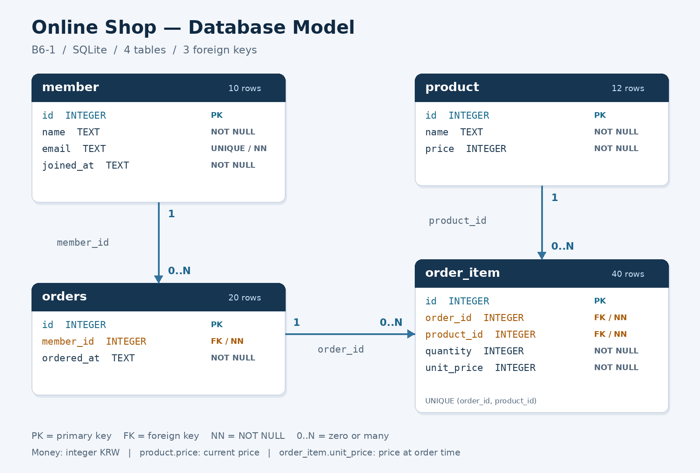

# B6-1 학습 가이드

## 1. 데이터가 나뉘는 이유

한 회원의 이름과 이메일을 주문마다 반복해서 적으면 정보를 고칠 때 여러 행을 수정하게 됩니다.
이 프로젝트는 회원 정보는 `member`, 상품 정보는 `product`, 주문 사실은 `orders`와 `order_item`에 저장합니다.
PK/FK로 연결하고 필요한 화면 모양은 JOIN으로 만들어 냅니다.

엑셀도 표와 수식으로 정보를 관리할 수 있습니다. 관계형 DB의 학습 포인트는
**테이블 간 관계와 제약조건을 DB가 검사하고, SQL로 연결·검색·집계한다**는 것입니다.
데이터 양만으로 둘을 구분하는 것은 적절하지 않습니다.

## 2. 한 행의 의미와 관계



| 테이블 | 한 행의 의미 | PK | FK |
|---|---|---|---|
| member | 회원 한 명 | id | 없음 |
| product | 상품 한 종류 | id | 없음 |
| orders | 회원이 한 번에 주문한 한 건 | id | member_id → member.id |
| order_item | 한 주문에 포함된 상품 한 종류 | id | order_id → orders.id, product_id → product.id |

회원은 주문이 0건일 수도 있고 여러 건일 수도 있습니다. 상품 역시 아직 주문되지 않았을 수 있습니다.
주문과 상품은 주문 상세를 통해 연결됩니다. 한 주문에 여러 상품, 한 상품에 여러 주문이 연결될 수 있습니다.
이 연결을 1:N 관계 두 개로 풀어 표현하는 것이 `order_item`의 역할입니다.

주문 1번은 **키보드 1개 + 마우스 2개**입니다.
주문 수는 1, 상세 행 수는 2, 구매 수량은 3으로 각각 의미가 다릅니다.

## 3. 제약조건이 지키는 규칙

| 조건 | 이 프로젝트의 예 |
|---|---|
| PK | 각 테이블의 `id`로 행 하나를 식별하며 중복 ID 차단 |
| NOT NULL | 이름·이메일·FK·수량 등 필수 정보 생략 차단 |
| UNIQUE | 회원 이메일 중복, 같은 주문의 동일 상품 중복 차단 |
| FK | 존재하지 않는 회원/주문/상품 참조 차단 |
| CHECK | 수량은 양의 정수, 가격과 주문 당시 단가는 0 이상의 정수 |
| ON DELETE RESTRICT | 자식이 참조하는 회원/주문/상품의 삭제 차단 |

FK만으로 NULL까지 막히는 것은 아니므로 필수 FK에는 NOT NULL도 붙였습니다.
부모가 반드시 자식을 하나 이상 가져야 한다는 규칙은 FK 자체가 보장하지 않습니다.
예를 들어 DB에 상세 없는 주문을 만들 수는 있지만, 제공한 샘플에는 모든 주문에 상세가 있습니다.

SQLite의 `INTEGER PRIMARY KEY`는 ID를 생략하면 정수 ID를 부여합니다. 샘플에서는 설명을 쉽게 하려고 ID를 직접 지정합니다.
SQLite는 타입 처리가 유연하므로 정수 수량/금액은 `typeof()` CHECK로 소수 입력도 차단합니다.
날짜/시간은 같은 형식의 TEXT로 저장하여 문자열 정렬과 시간 순서가 일치하게 합니다.

## 4. 15개 쿼리를 읽는 순서

| 번호 | 핵심 | 먼저 예상해 볼 결과 |
|---|---|---|
| Q01 | WHERE, ORDER BY | 50,000원 이상 4종: 웹캠 → 키보드 → 모니터 암 → SSD |
| Q02 | BETWEEN | 경계값 포함. 상품 2/3/4/8/11 |
| Q03 | LIKE | USB-C 허브, USB-C 케이블 |
| Q04 | ORDER BY, LIMIT | 주문 20/19/18/17/16 |
| Q05 | INNER JOIN | 20개 주문에 회원 이름 붙이기 |
| Q06 | INNER JOIN, 계산식 | 주문 1번: 69,000 + 2 × 25,000 = 119,000원 |
| Q07 | 네 테이블 JOIN | 회원 1의 주문 4건, 결과 상세 7행 |
| Q08 | LEFT JOIN | 20개 주문 + 주문 없는 회원 2행 = 22행 |
| Q09 | COUNT, GROUP BY | 회원 1/2는 4건, 3~8은 2건, 9/10은 0건 |
| Q10 | SUM, GROUP BY | 총 58개, 총 주문 금액 1,898,000원; 미판매 상품은 0 |
| Q11 | AVG, GROUP BY | 케이블은 상세 9건에서 18개 판매 → 평균 2개 |
| Q12 | 서브쿼리 | 평균 현재 가격 약 45,416.67원보다 비싼 5종 |
| Q13 | UPDATE | 현재 마우스 가격 30,000 → 35,000 → 복원 30,000원 |
| Q14 | DELETE | 상세 40번 삭제 → 전체 39행 → 복원 40행 |
| Q15 | CREATE INDEX | orders.member_id 검색 인덱스 생성 |

`GROUP BY`는 같은 회원/상품의 행들을 묶습니다. 집계 함수는 그 묶음마다 계산합니다.
이름이 같은 회원이 있을 수 있으므로 ID와 이름을 함께 그룹 기준으로 사용합니다.

`COUNT(*)`는 결과 행 자체를 셉니다. `COUNT(o.id)`는 NULL이 아닌 주문 ID만 셉니다.
Q09의 LEFT JOIN에서는 주문 없는 회원도 결과 행 하나를 차지하므로 `COUNT(o.id)`가 필요합니다.
또한 주문 횟수를 구할 때 상세까지 연결하면 한 주문이 상세 개수만큼 반복됩니다.
Q09는 `member`와 `orders`까지만 연결하여 주문을 정확히 셉니다.

Q10의 `SUM()`은 미판매 상품에 대해 NULL이 됩니다. `COALESCE(..., 0)`으로 0을 표시합니다.
Q11의 평균은 **상품별 상세 한 건당 수량**입니다. 회원당 평균, 일평균과 구분해서 설명하세요.
Q12의 안쪽 SELECT는 평균 가격 한 값을 만들고, 바깥 SELECT는 그 값과 상품 가격을 비교합니다.

## 5. 현재 가격과 주문 당시 가격

상품 2의 현재 가격은 30,000원입니다. 주문 1의 마우스는 당시 25,000원에 2개 판매되었습니다.
과거 주문 금액은 `quantity * unit_price`로 계산합니다.
Q13에서 현재 가격이 35,000원으로 바뀌어도 주문 1의 마우스 금액은 50,000원으로 유지됩니다.
날짜나 현재 상품 가격이 바뀌어도 주문 당시의 사실을 보존하기 위한 설계입니다.

## 6. VS Code에서 반복해서 공부하기

1. `sql/03_queries.sql`에서 한 쿼리의 설명과 SQL을 읽습니다.
2. 실행하기 전에 어떤 행이 나올지 예상합니다.
3. `py main.py run 8`처럼 해당 번호만 실행합니다.
4. `results/query_08.txt`에서 실제 SQL과 결과를 비교합니다.
5. 조건·정렬 방향 등을 하나씩 바꾸고 저장한 다음 다시 실행합니다.

Q번호 주석은 실행 도우미가 사용하는 구분자이므로 유지하세요.
변경한 쿼리가 기준 기대값과 달라지면 `check`가 FAIL일 수 있습니다. 해당 기준과 수정 의도를 비교하세요.
다른 의미의 쿼리로 바꾼 경우 그 결과가 곧 SQL 오류라는 뜻은 아닙니다.

## 7. 직접 SQL을 입력해 보기

```bash
py main.py shell
```

실습 모드 안에서 한 번에 다음 블록을 실행하면 변경과 복원을 비교할 수 있습니다.

```sql
SELECT id, name, price FROM product WHERE id = 2;
BEGIN;
UPDATE product SET price = 36000 WHERE id = 2;
SELECT id, name, price FROM product WHERE id = 2;
ROLLBACK;
SELECT id, name, price FROM product WHERE id = 2;
```

추가/삭제도 직접 연습할 수 있습니다. 아래 두 변경은 마지막에 모두 취소됩니다.

```sql
BEGIN;
INSERT INTO member (id, name, email, joined_at)
VALUES (100, '연습 회원', 'practice@example.com', '2026-10-01 10:00:00');
SELECT * FROM member WHERE id = 100;
DELETE FROM member WHERE id = 100;
SELECT COUNT(*) AS remaining FROM member WHERE id = 100;
ROLLBACK;
```

종료하려면 `.quit`을 입력합니다. 확정하지 않은 트랜잭션은 종료할 때 되돌립니다.
한 문장 실행은 `py main.py sql "SELECT COUNT(*) FROM orders;"`처럼 할 수도 있습니다.

## 8. 인덱스 이해하기

인덱스는 특정 조건에 맞는 행을 찾을 때 활용할 수 있는 별도 자료구조입니다.
Q15는 회원별 주문을 찾는 `WHERE member_id = ...`에 맞춰 `orders.member_id`에 인덱스를 만듭니다.
실제 적용 가능성은 `EXPLAIN QUERY PLAN` 결과에서 확인합니다. 엔진 버전에 따라 계획 문구는 다를 수 있습니다.
표본이 작으면 체감 속도 차이는 거의 없을 수 있으며, 인덱스는 저장 공간과 변경 시 유지 비용이 듭니다.
이 미션의 확인 사항은 **생성한 컬럼·검색 조건·적용 이유**입니다.
